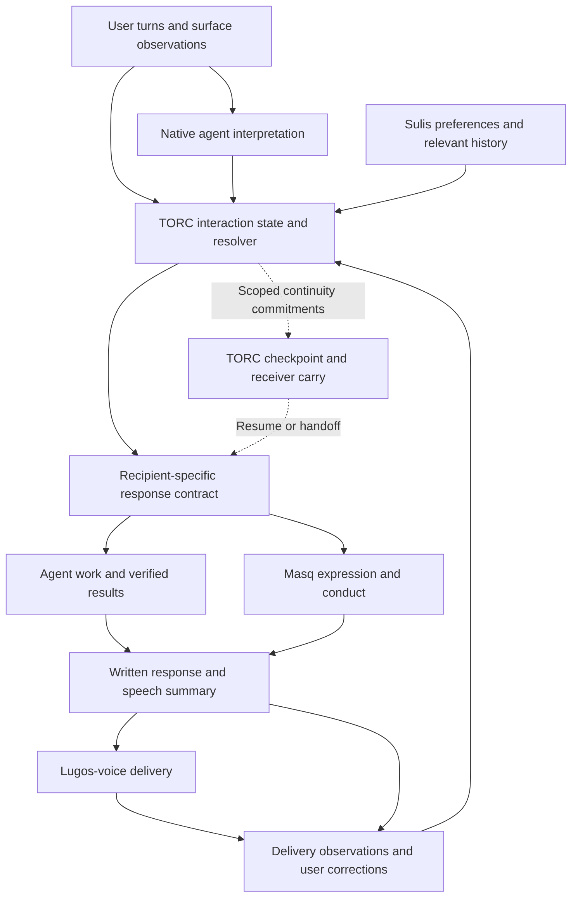
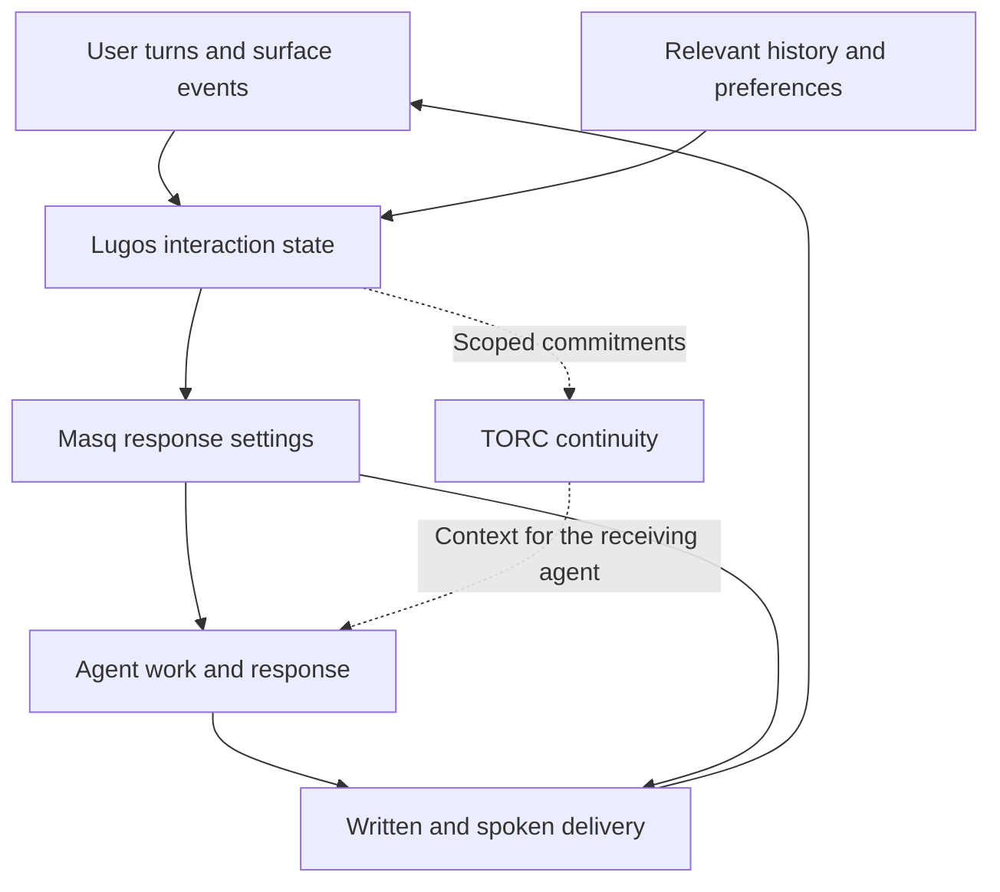

# Mirror: Adaptive Interaction and Response Projection

## Start here when picking this up

Implementation update, 2026-11-06: the [first local experiment](../mirror-response-contract.md)
now provides versioned response settings and delivery records, a text adapter,
an opt-in Windows lugos-voice consumer, and a deterministic handoff replay. It
tests contract delivery and fact preservation; live adaptive behavior remains
unverified. The original concept and conversation below are preserved.

**Working direction: TORC owns the shared adaptive interaction core and exposes its response contract to lugos-voice and other surfaces.** Native agents contribute interpretations, Sulis supplies durable preferences and history, Masq supplies persona expression, and lugos-voice supplies observations and handles speech delivery.

The design center, in the operator's words:

> the key design is adaptively responding to changing user patterns based on current context string and assumptions that can be gathered from history

This is a concept capture, not an implemented feature or a finalized runtime specification. The intended next session is after work on **Thursday, November 5, 2026**, around **7 PM America/New_York**.

The first discussion assigned too much interaction-state ownership to a generic Lugos layer. The later ownership discussion corrected that: **the shared resolver and its contract belong in TORC; lugos-voice is a consumer and a source of observations.** The original table and flow remain in the conversation appendix as historical proposals. They have not been silently rewritten.

### Contents

- [Concept and purpose](#concept-and-purpose)
- [Current ownership direction](#current-ownership-direction)
- [Revised flow](#revised-flow)
- [Independent adaptation controls](#independent-adaptation-controls)
- [State, history, and evidence](#state-history-and-evidence)
- [Voice and summarization](#voice-and-summarization)
- [Multiple agents and surfaces](#multiple-agents-and-surfaces)
- [Existing foundations and their limits](#existing-foundations-and-their-limits)
- [First experiment and next-session questions](#first-experiment-and-next-session-questions)
- [Full visible conversation](#full-visible-conversation)
- [Source references](#source-references)

## Concept and purpose

Mirror is a working name for an adaptive interaction mode. A profile may enable it, but the effective behavior is recalculated from the current request, recent dialogue, task, relevant history, and supported surface observations.

It should adapt vocabulary, explanation, summary selection, response length, conversational behavior, and spoken delivery. It should remain useful across native agent surfaces, text conversations, and lugos-voice.

The motivating examples were Caveman, Ponytail, drunk Claude, Dean, and the rewording adapters available in agent settings. Those illustrate different ways to shape expression or conduct. Mirror adds a continuing update process: what is appropriate for this user in this exchange can change from one turn to the next.

The core distinction is **how much work the task needs versus how much the user wants to hear right now**. An informal request can require deep analysis. Brief speech can accompany a complete report. A correction can require a change of approach rather than merely a different tone.

There are two recipients to fit:

| Recipient | Fit problem |
|---|---|
| Agent receiving context | What does this agent need to continue its responsibility, within its capabilities and context budget? |
| User receiving a response | What information, wording, amount of detail, and delivery are useful in the current interaction? |

This extends TORC's projection idea to interaction with the operator. It does not turn the operator into an agent lineage or make an inference about the user canonical truth.

## Current ownership direction

The following is the final working split from the conversation. Per-turn interaction resolution would be an explicit extension of TORC's current scope.

| Component | Responsibility |
|---|---|
| **TORC** | Own adaptation rules, scoped interaction state, precedence, expiration, and the response settings supplied to each recipient |
| **Native agents** | Interpret language and contribute tentative observations with supporting evidence |
| **Sulis** | Retain durable preferences and supply relevant history |
| **Masq** | Apply persona, wording, and conduct instructions within the resolved settings |
| **Lugos-voice** | Supply audio and session observations; handle spoken summaries, pacing, interruption, and playback |

Lugos integration remains the route for connecting existing components and surfaces. It should not grow a competing authoritative interaction model beside TORC. Execution harnesses and Autowork retain their execution and permission responsibilities.

TORC already owns receiver-fitted continuity, while its current boundaries leave inference, broad memory, provider routing, and persona custody with their existing owners. The proposed extension should preserve those boundaries. The native agent supplies an interpretation; TORC governs its scope, freshness, precedence, and use in a projection. [S1] [S2] [S3]

“Service” means a shared callable capability first. A local interface and cached, versioned settings per active interaction can precede any daemon or network service. Audio timing, stop, and interruption remain local to lugos-voice.

## Revised flow

**This diagram incorporates the final TORC ownership correction.** The original diagram is preserved in the transcript under Message 12.



The live loop updates current interaction settings. The continuity loop carries relevant commitments at meaningful boundaries. They can share TORC ownership without recording every transient estimate as a canonical lineage revision or making TORC a synchronous audio dependency.

Adaptation has two application points:

1. **Before the agent acts or responds:** influence whether to continue, explain, ask a necessary question, or repair an interpretation.
2. **At delivery:** select and express the written or spoken result for the current recipient.

A final rewording pass cannot repair an earlier unnecessary question, an irrelevant investigation, or a premature stop.

## Independent adaptation controls

| Control | What changes |
|---|---|
| **Language** | Familiar terminology, technical vocabulary, sentence structure, formality |
| **Explanation depth** | How much reasoning, background, and qualification the task needs |
| **Information selection** | Which results, uncertainties, blockers, or decisions matter now |
| **Turn length** | How much to deliver in this particular message or spoken segment |
| **Interaction behavior** | Continue working, explain, ask a necessary question, or repair a misunderstanding |
| **Delivery** | Written detail, spoken summary, pacing, interruption, and timing |

Shorthand does not establish low expertise. Plain terminology does not establish a simple problem. A short spoken update does not justify incomplete work. Frustration may call for missing evidence or a correction rather than less detail. Silence alone establishes neither absence nor completion.

The original concept request is itself a fixture: casual language and shorthand, substantial technical depth, exploratory intent, and unknown screen attention. The repeated “broke” messages are another fixture: resume useful delivery while retaining the original objective.

A persona can retain its recognizable register while these controls change. A chosen Dean profile, for example, need not be replaced every time the appropriate explanation length changes.

## State, history, and evidence

### Three timescales

| Timescale | Examples | Update behavior |
|---|---|---|
| **Established preferences** | Preferred terminology, recurring formatting choices, explicit standing instructions | Change conservatively |
| **Task or session context** | Current objective, demonstrated familiarity with this subject, unresolved misunderstandings | Change as the task develops |
| **Current-turn intent** | “Explain that,” “just the command,” “keep going,” “I’m back at the computer” | Apply immediately |

Current explicit intent wins over an inferred historical preference. History provides context without trapping the user in a permanent classification.

State needs an explicit scope: conversation, task, surface, and relevant participant or lineage. Temporary friction in one conversation must not become a global user trait. An idle desktop does not establish that the user is absent from a phone or another surface.

### Distinguish evidence from interpretation

| Category | Example | Treatment |
|---|---|---|
| Explicit request | “Keep spoken updates brief, but finish the report.” | Apply immediately within the stated scope; carry when relevant |
| Observation | The same task interpretation was corrected twice | Retain source event references and timing |
| Hypothesis | Interaction repair is probably needed | Keep uncertainty and expiration; revise when evidence changes |
| Selected adjustment | Lead with the corrected answer and stop repeating the old explanation | Apply as a response setting without claiming it proves an emotional state |

The proposed example record from the conversation:

```yaml
observation:
  kind: repeated_scope_correction
  evidence: [user_turn_41, user_turn_43]

interpretation:
  repair_needed: likely
  confidence: medium
  scope: current_task

response_adjustment:
  lead_with: corrected_answer
  repeat_previous_explanation: false

expires_when:
  - misunderstanding_resolved
  - task_changes
```

This is illustrative, not an existing TORC schema or a claim that model confidence is calibrated. It is an operational observation based on conversation, not a readout of hidden reasoning or a native emotional sensor.

The native agent can apply standing adaptation guidance during the current response. Metadata emitted with that response can influence speech and later turns. Metadata available only after the response cannot retroactively change earlier decisions.

Keep user-authored material separate from assistant responses, tool output, quotations, copied documents, and speech-recognition artifacts. Otherwise the system can learn its own output habits or mistake transcription quality for user expertise or intent.

The agent's self-model should carry its responsibilities. The user's current interaction context should retain its own scope and evidentiary status. “I owe a complete analysis with brief spoken updates” is an agent commitment. “The user said they are away from the screen” is a scoped observation.

## Voice and summarization

Generate the written response and spoken response from the same substantive result. Preserve completion status, verification status, uncertainty, necessary conditions, and pending decisions across both.

Illustrative spoken result:

> The patch is ready and the tests pass. Playback on the actual PC still needs checking.

The wording is short while retaining the unverified part. A summary must not turn “changed” into “fixed,” “simulated” into “verified on hardware,” or a pending decision into a completed action.

The Windows `summaryForSpeech` path inspected during the conversation prefers an explicit spoken line, handles questions separately, and otherwise selects the first paragraph with sentence and character limits. Its defaults include two sentences and 240 characters. The shared selector preserves decision context or substitutes a notice to read the written reply when the question is too long. These are existing integration points, not evidence that Mirror already exists. [S7] [S8]

An explicitly away-from-screen interaction needs a suitable route for a long decision: complete spoken context in manageable segments, or a clearly deferred decision. Merely directing the user to a screen they cannot see can stall the task.

Keep interpretation and generation economical. Use inexpensive processing for explicit instructions and supported surface events, reuse the main agent's interpretation, and supply current settings to existing summary generation. The first prototype should not require separate serial model calls for emotion detection, summary, restyling, and style review.

Check hard length limits after styling. Attach speech to its session, source turn, and response revision. Interruptions and redirection must invalidate stale output. Speech completion does not establish that the user completed an instruction or approved an action.

## Multiple agents and surfaces

The same user instruction needs different recipient projections:

| Recipient | What it needs to carry |
|---|---|
| Research agent | Complete the assigned investigation and return sufficient evidence |
| Implementation agent | Complete the change and required verification |
| User-facing coordinator | Integrate the full result and lead with what matters now |
| Speech renderer | Deliver a brief outcome, blocker, or necessary question |
| Document renderer | Produce the complete requested report |

The example is: “i’m walking around. keep it short but finish the whole analysis.” The analysis obligation and delivery preference stay independent. When the user returns and asks for details, the full result should already be available.

Three ownership questions remain distinct:

- TORC determines which activation represents a lineage.
- Execution coordination determines which agent owns a piece of work.
- Lugos-voice determines which utterance may play now.

An interrupted utterance does not automatically cancel the underlying task. A speaking agent does not acquire another worker's execution authority.

Deduplicate shared observations by their original evidence. Three agents repeating one inference are not three independent observations. Agents may contribute interpretations; one resolver should produce the effective response settings for the conversation.

### Adapter capability levels

| Level | Available behavior |
|---|---|
| Instruction-only | The native agent adapts within its existing conversation context |
| Context-aware integration | A supported hook or API supplies current shared interaction state |
| Output-only integration | A renderer adapts final text or speech, with limited influence over earlier decisions |

Capabilities must be checked per CLI, desktop application, web surface, and voice path. One provider's hooks do not establish equivalent support elsewhere.

### Platform qualification

This concept targets a portable core and independent surface adapters. No live platform qualification was performed in this conversation.

| Area | Intended platforms or surfaces | Status to preserve |
|---|---|---|
| TORC interaction contract | Portable TORC library/CLI; Windows and macOS consumers | Proposed extension; authoritative implementation test platform still to be selected |
| lugos-voice integration | Existing Windows and macOS speech paths | Inspect and qualify each path separately; Windows observations do not prove Mac behavior |
| Native text adapters | Agent CLI, desktop, web, or supported API surfaces | Capability-specific; unknown support stays unknown |
| Cross-surface continuity | One task moving between text, voice, and a receiving agent | Proposed experiment; not demonstrated |

## Existing foundations and their limits

- **TORC:** receiver-fitted carry, lineage provenance, and separation of the control envelope from the execution capsule are existing foundations. Per-turn adaptive interaction state and human-facing response projections remain proposed extensions. [S1] [S2] [S3] [S4]
- **Masq:** existing presentation and conduct kinds provide a place to express different settings. A visible Mirror mode could compose the required pieces without collapsing their responsibilities. [S5] [S6]
- **Lugos-voice:** existing speech selectors and delivery coordination offer initial integration points. This capture does not assert live installation or health on any machine. [S7] [S8]
- **Native styles:** Claude Code output styles are instructions, not enforcement. A custom style intended to preserve engineering behavior requires the documented `keep-coding-instructions` setting. [S9]
- **Context delivery:** the investigated Masq composition failure was corrected to a hook-context delivery failure. The earlier apparent suppression result was voided. The follow-up establishes behavior for its limited fixture, not universal style reliability. [S10] [S11]
- **Hook inputs:** current Claude Code documentation caps individual hook-context strings at 10,000 characters and can replace over-limit content with a preview and file reference. `UserPromptSubmit` can also fire for background or scheduled events. Observe source identity rather than treating every such event as a human message. [S12]
- **Reference recipes:** Caveman supplies compression and fidelity rules. The Ponytail implementation inspected also affects engineering conduct. Neither inspected skill file supplies this proposed shared adaptive interaction model. [S13] [S14]

Separate three checks: settings calculated, settings delivered, and behavior observed. A successful write or injection alone does not prove that the receiving agent acted on the intended context.

## First experiment and next-session questions

The smallest useful integration is a TORC response contract consumed by one lugos-voice summary path, with one text adapter able to consume the same contract.

1. Define compact state with evidence, scope, uncertainty, expiration, and recipient settings.
2. Resolve selected persona, explicit current requests, and relevant interaction state.
3. Produce a complete written result and a faithful spoken response.
4. Resume or hand off once through TORC, preserving commitments while keeping temporary assumptions temporary.

### Cases to preserve for evaluation

| Case | Expected behavior |
|---|---|
| Informal shorthand asking for architecture exploration | Casual wording with substantial technical depth |
| Narrow factual question | Direct, appropriately short answer |
| “Keep going” or “broke” after a stall | Deliver useful work and continue the original objective |
| Repeated scope corrections | Change the approach and answer the corrected request |
| Away from the screen | Brief usable speech with complete necessary decision context |
| Return and request detail | Expand delivery immediately without redoing lost work |
| Worker handoff | Preserve full task obligations while tailoring the recipient's context |
| Quoted or garbled input | Avoid learning it as the user's style or inferring unsupported traits |
| Multiple agents echo one hypothesis | Count the underlying evidence once |
| Interrupted or superseded speech | Cancel stale playback without silently changing task ownership |

Measure preserved facts, unnecessary corrective turns, time to a useful response, added model cost, and stale or canceled speech. Textual resemblance is secondary to usefulness.

Questions left open for the next session:

- What is the smallest TORC schema extension that distinguishes live interaction estimates from accepted lineage commitments?
- Which precedence rules can be deterministic, and which interpretations come from the native agent?
- How are scope changes, return-to-screen events, and correction signals represented without pretending presence is known?
- Which preferences can be retained through existing Sulis paths, and which estimates should expire?
- What must every recipient receive, and what can be omitted under its context budget?
- Which exact voice and text adapter paths form the first demonstration?
- What latency and cost baseline will determine whether the extra machinery earns its place?
- How will summary fidelity, delivered context, and actual behavior be checked independently?

The first demonstration should complete one task while the operator moves from detailed desktop discussion to brief voice updates and back, including one agent handoff. The explanation should change while the task obligations remain intact.

## Full visible conversation

### Capture scope

This appendix preserves the user and assistant conversational text available in this session, beginning with the concept request and ending with the request to archive it. It includes visible progress messages and the recovery messages. Tool payloads, private reasoning, internal instructions, unrelated memory, and subagent deliberations are outside this transcript.

Message order is preserved without invented per-message timestamps. One externally supplied “broke” message is identified separately because it arrived as outside-thread conversation context. Heading levels are normalized for nesting, and application-specific citation widgets are rendered as ordinary source links. The tables, Mermaid flow, and YAML example are preserved.

### Message 01: User

i want to explore a new concept that would tie in with masq and each of the rewording language adapters the different agent surfaces have in their settings to mutate responses and output to basically instead of doing profiles or maybe just by adding a new profile do a mirror match of the user so if the user is using shorthand or using non-technical terms then the output responses would be shaped to match similar to the way the caveman or ponytail external skills out there on the internet do or kinda like the drunk claude or the dean voice do but... across the board and especially for summarizing so we could try to shape the voice responses in lugos-voice to match the speaker and potentially start to even try to influence behavior or identify things the native agent might detect but not put into words like sensing frustration or just doing short turns when user isnt at terminal as a behavioral influence on how the responses get shaped... its complicated i know but we can handle it :D

####

the key design is adaptively responding to changing user patterns based on current context string and assumptions that can be gathered from history

### Message 02: Assistant progress

I’m treating this as a layer that changes with the conversation: it would shape wording, summaries, and how the agent takes its next turn. I’m using the Personal Context skill to check the masq and lugos-voice decisions we already have, then I’ll work through how adaptation could fit.

### Message 03: Assistant progress

Masq already separates presentation from conduct, which gives this a useful place to fit. Its docs also record a failure where adding a style profile caused required reporting details to disappear. The adaptive mode needs to control both axes explicitly so shortening a response doesn’t quietly remove evidence, unresolved work, or a needed question.

### Message 04: Assistant correction

The follow-up evaluation corrects that earlier explanation: those requirements were lost because the hook context was truncated, not because the profiles suppressed each other. That gives us a concrete requirement for this design: each adapter needs a small, versioned context update, with a way to verify that it actually reached the agent.

### Message 05: Assistant progress

Your message is a useful test case: it’s casual and full of shorthand, but it calls for substantial technical exploration. Mirror needs separate controls for wording, depth, and turn length. For voice, I’d also distinguish “give me a short answer” from “I’m away from the screen,” since those call for different behavior.

### Message 06: User

and perhaps this is where we have lugos/torc step in... lets keep it complicated XD

### Message 07: Assistant progress

Then I’d put the shared conversation state in Lugos and use TORC to govern which observations each agent can contribute and which behavioral changes it may make. That would let a voice session inform a desktop session without turning a temporary “shorter please” into a permanent preference everywhere. I’m checking TORC’s existing boundaries before assigning it that role.

### Message 08: Assistant progress

TORC already has a strong fit here: it separates the full control record from a compact execution capsule tailored to the receiving agent. I’d use that to carry accepted interaction commitments across handoffs, while Lugos keeps the fast, temporary estimate of the current conversation. The receiving agent could inherit “lead with the result during this troubleshooting task” without inheriting “Matthew is frustrated” as an established fact.

### Message 09: Assistant progress

There are two separate decisions to preserve: how much work the task needs, and how much you want to hear right now. TORC’s projections could give a research agent the full analysis obligation while giving the speaking agent a brief-update requirement. I also found that the current Windows voice fallback can take the first paragraph of a reply, so choosing the right information for speech is a concrete improvement point.

### Message 10: User

broke you

### Message 11: User

broke

### Message 12: Assistant substantive response

I got buried in the repo checks and kept you waiting. Here’s the actual design.

**Yes, Lugos and TORC belong in this. I’d make “Mirror” a shared adaptive interaction mode, exposed through Masq, with its behavior recalculated from the current conversation and relevant history.**

TORC gives this a particularly useful connection: there are **two receivers to fit**:

- The agent receiving the context it needs to continue the work.
- You receiving the explanation, result, question, or spoken update.

Those receivers need different amounts and forms of information. A research agent might need the complete investigation while you need a ten-second spoken result.

And this exchange supplies a test case: your original message uses shorthand while asking for deep exploration. Your later “broke” means the interaction has stalled and needs to deliver. Neither should cause the system to conclude that you generally want shallow answers.

#### 1. Mirror needs several independent controls

The central question would be:

> Given what the user is trying to accomplish, how they are communicating now, and what we already know, what response would be easiest for them to use?

I’d keep these controls separate:

| Control | What changes |
|---|---|
| **Language** | Familiar terminology, technical vocabulary, sentence structure, formality |
| **Explanation depth** | How much reasoning, background, and qualification the task needs |
| **Information selection** | Which results, uncertainties, blockers, or decisions matter now |
| **Turn length** | How much to deliver in this particular message or spoken segment |
| **Interaction behavior** | Continue working, explain, ask a necessary question, or repair a misunderstanding |
| **Delivery** | Written detail, spoken summary, pacing, interruption, and timing |

That separation prevents several obvious failures:

- Shorthand does not establish low expertise.
- Plain terminology does not establish a simple problem.
- A short spoken update does not justify incomplete work.
- Frustration does not necessarily call for a shorter answer. Sometimes it calls for finally supplying the missing evidence.
- Silence does not establish that you left the terminal or completed an instruction.

For your original request, Mirror should resolve something like: **casual wording, substantial technical depth, exploratory discussion, and no assumption about whether you are looking at a screen.**

A selected persona could remain recognizable throughout. Dean could still sound like Dean while changing how much explanation he gives and when he speaks.

#### 2. Where the responsibilities belong

I checked the current repository material. Masq already separates presentation from conduct. TORC already owns the shaping of continuity for a receiving agent, including a compact execution capsule distinct from its fuller control record. Those are useful existing foundations; the adaptive integration described here is a proposal. [Masq profile contract](https://github.com/mdn87/masq/blob/main/docs/PROFILE_FORMAT.md) · [TORC carry ownership](https://github.com/mdn87/torc/blob/master/docs/decisions/0004-torc-is-always-in-charge.md) · [TORC capsule separation](https://github.com/mdn87/torc/blob/master/docs/decisions/0005-separate-control-and-execution-capsules.md)

Here is how I’d divide the work:

| Component | Proposed responsibility |
|---|---|
| **Lugos integration layer** | Collect current user turns and supported surface events; maintain the current interaction state |
| **Sulis** | Supply relevant history and retain established, scoped preferences |
| **TORC** | Govern what interaction commitments and context survive session changes and handoffs; fit that material to the receiving agent |
| **Masq** | Combine the chosen persona with current presentation and conduct settings |
| **Lugos-voice** | Select and deliver the spoken response, including chunking, interruption, cancellation, and speech ownership |
| **Execution harness / Autowork** | Carry out the work under the existing task and permission boundaries |

This follows the ownership boundaries already documented for TORC, Sulis, and Autowork. TORC references memory and execution evidence while the existing owners retain their respective responsibilities. [TORC integration boundaries](https://github.com/mdn87/torc/blob/master/docs/integration-boundaries.md)

**The new piece is the shared interaction-state resolver.** It could begin as a small module used by the existing integrations. There is no need to make a new permanent service the starting assumption.

Masq should also remain useful on its own. A standalone Mirror profile could adapt within the context the native agent already sees. Lugos and TORC would add coordinated state and continuity across surfaces.

#### 3. Use a fast conversation loop and a slower continuity loop

This is where the architecture gets more interesting.

##### The fast loop

Every meaningful user turn updates a small working estimate:

- What are we doing?
- What does the user want from this next response?
- What terminology are they using?
- Has the agent missed or repeated something?
- What delivery surface is active?
- Which assumptions are supported, and which remain unknown?

That estimate can change immediately when you say “go deeper,” “just tell me whether it worked,” or “I’m walking around.”

##### The continuity loop

When a session resumes, work changes hands, or an enduring task commitment changes, the relevant material goes through TORC’s continuity path.

For example:

> “Keep the spoken updates brief, but finish the complete report.”

That contains two commitments worth carrying. A temporary guess that you seem distracted may have little value to the next agent.



The solid paths represent the live interaction. The dashed paths represent material being carried through continuity boundaries.

TORC’s existing P5 design already compiles a carry according to the receiver’s budget and reads lineage history to recover commitments that a previous summary omitted. That mechanism is directly relevant here, although its existence does not prove that this new adaptation would improve real interactions. [P5 receiver-fitted carry](https://github.com/mdn87/torc/blob/master/docs/p5-receiver-carry.md)

A distinction matters: **the agent’s self-model and the user’s interaction state are different records.**

An agent commitment could be:

> “I owe the user a complete analysis and brief spoken updates.”

The current interaction estimate could be:

> “The user said they are away from the screen.”

Those have different lifetimes and different evidentiary status.

#### 4. History should inform the next response without trapping the user

I’d use three timescales:

| Timescale | Examples | Update behavior |
|---|---|---|
| **Established preferences** | Preferred terminology, recurring formatting choices, explicit standing instructions | Change conservatively |
| **Task or session context** | Current objective, demonstrated familiarity with this subject, unresolved misunderstandings | Change as the task develops |
| **Current-turn intent** | “Explain that,” “just the command,” “keep going,” “I’m back at the computer” | Apply immediately |

Current explicit intent should override an inferred historical preference.

If you usually want concise answers but ask for a full architecture discussion, the system should give the architecture discussion. If you usually discuss code comfortably but ask what a particular term means, it should explain that term without downgrading its entire estimate of your expertise.

The state also needs scope. A response preference might apply to this conversation, this task, this device, or all spoken updates. A tense troubleshooting exchange should not create a global “Matthew is frustrated” setting that follows you into unrelated work.

There is another easy feedback error: **the system must distinguish your writing from its own writing.** Otherwise, it can start learning from the responses it generated and gradually reinforce its own habits. Quoted documents, tool output, copied messages, and speech-recognition artifacts need separate provenance too.

#### 5. The native agent can report useful impressions

Your idea about things an agent may notice but never put into words is worth pursuing.

I’d have it produce a small, structured **interaction observation** where the surface supports that. For example, this is a proposed record shape:

```yaml
observation:
  kind: repeated_scope_correction
  evidence: [user_turn_41, user_turn_43]

interpretation:
  repair_needed: likely
  confidence: medium
  scope: current_task

response_adjustment:
  lead_with: corrected_answer
  repeat_previous_explanation: false

expires_when:
  - misunderstanding_resolved
  - task_changes
```

This captures something actionable. It does not require an emotional diagnosis.

The agent can notice that you corrected the same interpretation twice, connect those corrections to its previous answer, and change its behavior. The useful adjustment is to address the missed objective, verify the disputed point, and continue from the correction.

For your “broke” messages here, the adjustment should be: **deliver the accumulated result and stop extending the investigation.**

That interpretation remains a hypothesis grounded in the conversation. A model-generated confidence label is not a calibrated emotional measurement.

There is also a timing constraint:

- The native agent can apply a standing adaptation instruction while composing its current response.
- A structured observation emitted with that response can inform speech delivery and the next turn.
- An observation available only after the response cannot retroactively improve earlier choices.

That is why a final rewording pass alone cannot provide the whole feature. Adaptation needs to affect the agent before it chooses whether to explain, ask, continue, or stop.

#### 6. Summarization is probably the strongest first application

A useful spoken summary depends on the user’s current objective.

After a long debugging run, you might need:

> “The patch is ready and the tests pass. Playback on the actual PC still needs checking.”

That is an illustrative result, but it demonstrates the requirement: the summary preserves what was done, what was verified, and what remains unresolved.

If you are actively investigating the bug, you may also need the cause and evidence. If you are away from the screen, the spoken response should prioritize the result, blocker, or decision.

The current Windows `summaryForSpeech` path already prefers an explicit spoken line, handles questions separately, and otherwise falls back to the first paragraph with sentence and character limits. Its defaults include two sentences and 240 characters. This gives us a concrete integration point. [Current speech-summary code](https://github.com/mdn87/lugos-voice/blob/main/hooks/speak-response.mjs)

I’d extend that into a response process with two outputs from the same substantive result:

1. **The written response**, with the detail the task requires.
2. **The spoken response**, selected for the current listening situation.

Both must preserve the same completion status, uncertainty, necessary conditions, and outstanding decisions.

The current shared speech selector also substitutes a notice to read the written reply when a decision is too long to speak within its limit. That protects against speaking an incomplete question, but an explicitly away-from-screen interaction needs another route: a complete spoken decision in manageable segments, or a clearly deferred decision. [Shared speech selector](https://github.com/mdn87/lugos-voice/blob/main/hooks/spoken-line.mjs)

##### Keep the latency under control

I’d reuse the main agent’s understanding and any existing summary generation. The first design should avoid a mandatory chain of separate calls for detecting mood, summarizing, restyling, and checking style.

Use inexpensive processing for explicit instructions and surface state. Let the native agent interpret nuanced language. Generate the spoken summary with the current response settings already available.

Any final length checks must run after styling. A persona pass can make a previously valid summary too long.

For audio, keep the existing speech controller responsible for interruption and cancellation. Every generated utterance should remain attached to its session, source turn, and response revision so an old summary cannot play after the user has redirected the conversation.

#### 7. TORC becomes especially useful with multiple agents

Suppose you say:

> “i’m walking around. keep the voice stuff short but finish the report.”

The shared instruction should produce different projections for different recipients:

| Recipient | What it needs to carry |
|---|---|
| Research agent | Complete the assigned investigation and return sufficient evidence |
| Implementation agent | Complete the change and required verification |
| User-facing coordinator | Integrate the full result and lead with what matters now |
| Speech renderer | Deliver a brief outcome, blocker, or necessary question |
| Document renderer | Produce the complete requested report |

Broadcasting “be brief” to every participant could degrade the work. TORC’s receiver-specific carry provides a place to preserve the obligation while changing which parts each participant receives.

There are three distinct ownership questions:

- **TORC:** Which activation represents this lineage?
- **Execution coordination:** Which agent owns this piece of work?
- **Lugos-voice:** Which utterance may play now?

A worker can continue its task while another agent speaks. Interrupting speech does not automatically cancel the underlying work.

Multi-agent observations also need deduplication. If one agent infers frustration and passes that inference to two workers, their agreement is still based on one original event. Three repeated interpretations should not become three independent pieces of evidence.

I’d let agents contribute observations, while one resolver produces the effective interaction settings for the conversation. That keeps several agents from independently rewriting a shared user model.

#### 8. A profile can activate Mirror, while adapters provide different levels of support

A new Masq presentation profile is enough to try the basic instruction:

> Adapt language and explanation to the current user context, while preserving the task’s required substance.

The fuller behavior would need an accompanying conduct component because deciding when to ask, continue, or repair an interaction goes beyond wording. Masq already has that distinction, so one visible Mirror mode could activate the appropriate pieces. [Masq composition model](https://github.com/mdn87/masq/blob/main/README.md)

The examples you mentioned illustrate this split. Caveman includes explicit preservation rules for technical content and exceptions when compression would obscure meaning. The Ponytail implementation I found also changes engineering choices and workflow. Those are useful references for presentation and conduct, respectively. [Caveman](https://raw.githubusercontent.com/JuliusBrussee/caveman/main/skills/caveman/SKILL.md) · [Ponytail](https://raw.githubusercontent.com/DietrichGebert/ponytail/main/skills/ponytail/SKILL.md)

Across surfaces, I’d define capability levels:

- **Instruction-only:** The native agent adapts using its available conversation context.
- **Context-aware integration:** A supported hook or API supplies current shared interaction state.
- **Output-only integration:** A renderer adapts the final text or speech, with limited influence over earlier agent behavior.

Each adapter should declare which level it actually supports.

For Claude Code specifically, output styles are instructions rather than enforcement. Custom styles also need `keep-coding-instructions: true` when the intent is to retain its engineering instructions. [Claude Code output styles](https://code.claude.com/docs/en/output-styles)

There is a concrete delivery lesson in your own Masq evaluations: an apparent composition failure was traced to oversized hook context. The follow-up measured behavior only after fixing delivery. [Masq delivery investigation](https://github.com/mdn87/masq/blob/main/evals/composition/03-hook-context-limit.md)

Current Claude Code documentation likewise caps each hook context string at 10,000 characters and substitutes a preview and file reference above that limit. It also says `UserPromptSubmit` can fire for background-agent and scheduled activity, so that event alone cannot establish that a human just spoke. [Claude Code hooks](https://code.claude.com/docs/en/hooks)

The adapter therefore needs to distinguish three things: the settings it calculated, the settings actually delivered, and the behavior that followed.

#### 9. The first prototype should prove adaptation across transitions

I’d make the first slice:

1. **A compact interaction-state format**, with evidence, scope, uncertainty, and expiration.
2. **A Masq resolver**, combining the selected persona, explicit requests, and current interaction state.
3. **One text-and-voice path**, producing a complete written result and a faithful spoken response.
4. **One TORC resume or handoff**, proving that the right commitments survive while temporary assumptions remain temporary.

The useful evaluation cases would be:

- Informal shorthand asking for deep technical exploration.
- A narrow factual question needing a short answer.
- “Keep going” after the agent stalled.
- Repeated corrections requiring a change of approach.
- Moving away from the screen, then returning and asking for detail.
- A handoff where the worker needs full context but the spoken update should stay brief.

Measure preserved facts, unnecessary corrective turns, time to a useful response, added model cost, and stale or canceled speech. Textual resemblance to the user is a secondary measure.

**The first demonstration should complete one task while you move from detailed desktop discussion to brief voice updates and back, including one agent handoff. The explanation should change with you while the task obligations remain intact.**

### Message 13: User, supplied from outside the Codex thread

broke

Capture note: this message was supplied as conversation context after the preceding response. No more precise timestamp or placement is available.

### Message 14: User

brokebroke

### Message 15: Assistant recovery response

I overworked the answer and stalled the conversation.

**Mirror would be a live interaction mode.** I’d have Lugos track the current exchange, TORC carry relevant commitments between agents and sessions, Masq shape wording and conduct, and lugos-voice shape what gets spoken.

The crucial separation is **how much work the task needs** versus **how much you want to hear right now**. Your shorthand can call for deep work with a compact response. A correction should change the approach. Being away from the screen should change delivery.

A profile could enable Mirror, but its settings would update each turn. Temporary assumptions would expire instead of becoming permanent personality labels.

### Message 16: User

my take is this belongs in torc and extends as a service to lugos-voice? or would it be the other way around?

### Message 17: Assistant progress

I’ll check TORC’s ownership rules against that split. The key question is whether TORC should own the adaptation contract while lugos-voice supplies live observations and handles delivery.

### Message 18: Assistant final ownership direction

**I’d put the shared core in TORC and expose it to lugos-voice.** Voice would both contribute observations and consume the resulting interaction settings.

My earlier split gave generic Lugos integration too much ownership and made TORC too passive.

#### Why TORC is the better owner

Your concept needs a coherent answer to questions that apply across every surface:

- What does the user need from this interaction now?
- Which preferences are established, and which are temporary assumptions?
- What should change when the user corrects the agent or switches surfaces?
- What must the next agent inherit?

Putting that logic inside lugos-voice would make text-only agents depend on an audio component, or encourage each surface to recreate its own interpretation.

TORC already owns shaping context for the receiving agent and preserving commitments across changes of session or agent. **This would extend that projection model to how the agent interacts with the user.** That is a proposed extension of its scope; the current continuity machinery does not already implement a live interaction model. [TORC’s ownership decision](https://github.com/mdn87/torc/blob/master/docs/decisions/0004-torc-is-always-in-charge.md)

#### The ownership split I’d use

| Component | Responsibility |
|---|---|
| **TORC** | Own adaptation rules, scoped interaction state, precedence, expiration, and the response settings supplied to each recipient |
| **Native agents** | Interpret language and contribute tentative observations with supporting evidence |
| **Sulis** | Retain durable preferences and supply relevant history |
| **Masq** | Apply persona, wording, and conduct instructions within the resolved settings |
| **Lugos-voice** | Supply audio and session observations; handle spoken summaries, pacing, interruption, and playback |

There is one important boundary: TORC currently excludes model inference, provider routing, and persona custody. We can preserve that separation by having the native agent supply interpretations while TORC owns their lifecycle and resolves what takes effect. Masq continues supplying the actual persona instructions. [Existing integration boundaries](https://github.com/mdn87/torc/blob/master/docs/integration-boundaries.md)

#### What that looks like in practice

You say:

> “i’m walking around. keep it short but finish the whole analysis.”

The native agent identifies the explicit requests. TORC resolves them into separate requirements:

- Complete the analysis.
- Keep spoken updates brief.
- Apply that delivery preference to this task.
- Reconsider delivery when you return or give a new instruction.

The research agent receives the full analysis obligation. Masq supplies the chosen register. Lugos-voice delivers the brief update.

When you return and say “show me the details,” TORC updates the interaction settings. The completed analysis is already available.

#### “Service” does not have to mean another daemon

I’d start with a callable TORC interface and a cached, versioned result for each active interaction. Lugos-voice can use the latest valid settings while keeping audio timing local. A pause, interruption, or stop command should remain immediately responsive.

The first integration should be **a TORC response contract consumed by one lugos-voice summary path**, with a text adapter able to consume the same contract. That proves the shared ownership before adding more surfaces.

### Message 19: User archival and reminder request

i want this entire conversation log as a concept doc in the torc repo so i can pick it up tomorrow after work, send dot a request to remind me around 7pm to look at it. make sure those flows and tables all get captured theyre gold. usosmart.

## Source references

Repository and documentation observations were checked during the conversation on 2026-11-04. They describe inspected sources, not live deployment verification. Links to other repositories and vendor documentation may change after capture.

- [S1: TORC original concept](0001-torc-original-concept.md)
- [S2: ADR 0004, TORC owns receiver carry](../decisions/0004-torc-is-always-in-charge.md)
- [S3: TORC integration boundaries](../integration-boundaries.md)
- [S4: ADR 0005, control records and execution capsules](../decisions/0005-separate-control-and-execution-capsules.md), with [P5 receiver-fitted carry](../p5-receiver-carry.md)
- [S5: Masq profile format](https://github.com/mdn87/masq/blob/main/docs/PROFILE_FORMAT.md)
- [S6: Masq README and composition model](https://github.com/mdn87/masq/blob/main/README.md)
- [S7: Windows speech response hook](https://github.com/mdn87/lugos-voice/blob/main/hooks/speak-response.mjs)
- [S8: Shared spoken-line selector](https://github.com/mdn87/lugos-voice/blob/main/hooks/spoken-line.mjs)
- [S9: Claude Code output styles](https://code.claude.com/docs/en/output-styles)
- [S10: Masq composition delivery investigation](https://github.com/mdn87/masq/blob/main/evals/composition/03-hook-context-limit.md)
- [S11: Masq composition evaluation after delivery correction](https://github.com/mdn87/masq/blob/main/evals/composition/04-conduct-under-register-delivered.md)
- [S12: Claude Code hooks](https://code.claude.com/docs/en/hooks)
- [S13: Caveman skill](https://raw.githubusercontent.com/JuliusBrussee/caveman/main/skills/caveman/SKILL.md)
- [S14: Ponytail implementation inspected](https://raw.githubusercontent.com/DietrichGebert/ponytail/main/skills/ponytail/SKILL.md)

[S1]: 0001-torc-original-concept.md
[S2]: ../decisions/0004-torc-is-always-in-charge.md
[S3]: ../integration-boundaries.md
[S4]: ../decisions/0005-separate-control-and-execution-capsules.md
[S5]: https://github.com/mdn87/masq/blob/main/docs/PROFILE_FORMAT.md
[S6]: https://github.com/mdn87/masq/blob/main/README.md
[S7]: https://github.com/mdn87/lugos-voice/blob/main/hooks/speak-response.mjs
[S8]: https://github.com/mdn87/lugos-voice/blob/main/hooks/spoken-line.mjs
[S9]: https://code.claude.com/docs/en/output-styles
[S10]: https://github.com/mdn87/masq/blob/main/evals/composition/03-hook-context-limit.md
[S11]: https://github.com/mdn87/masq/blob/main/evals/composition/04-conduct-under-register-delivered.md
[S12]: https://code.claude.com/docs/en/hooks
[S13]: https://raw.githubusercontent.com/JuliusBrussee/caveman/main/skills/caveman/SKILL.md
[S14]: https://raw.githubusercontent.com/DietrichGebert/ponytail/main/skills/ponytail/SKILL.md
